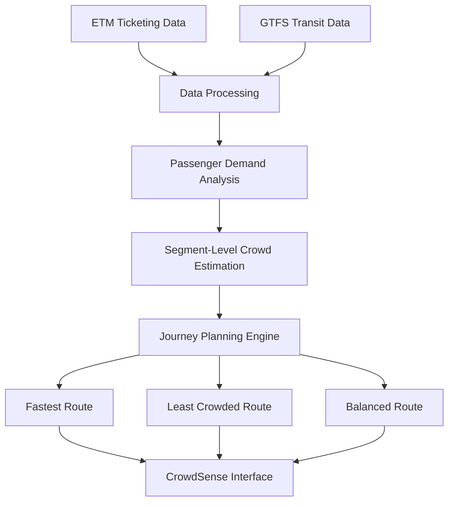

# CrowdSense 🚌
### Crowdedness-Aware Public Bus Journey Planner

**Know the Crowd. Choose Your Journey.**

CrowdSense is a data-driven bus journey planner that helps commuters choose better journeys by considering both travel time and estimated passenger crowdedness.

By analysing historical Electronic Ticket Machine (ETM) records and static GTFS data, CrowdSense estimates passenger demand across bus routes and journey segments, helping users compare faster and less crowded travel options.

## 🚨 Problem Statement

Traditional bus journey planners mainly focus on distance, travel time, and transfers. They rarely provide information about expected passenger crowdedness.

As a result, commuters may face unexpected crowding and have difficulty choosing comfortable alternative journeys.

## 💡 Our Solution

CrowdSense combines historical ticketing data and public transport information to estimate passenger demand and provide crowd-aware journey recommendations.

## ✨ Key Features

- **Crowd-Aware Journey Planning:** Search journeys using starting point and destination.
- **Crowd Estimation:** View estimated passenger demand across routes and segments.
- **Smart Recommendations:** Compare fastest, least crowded, and balanced journeys.
- **Interactive Map:** Explore bus stops, routes, and crowding patterns.
- **Historical Analytics:** Analyse passenger-demand trends by route and time.
- **Operator Dashboard:** Explore high-demand routes and peak travel periods.
- **Dataset Integration:** Upload ETM CSV/ZIP files and GTFS datasets.

## ⚙️ How It Works



## 📊 Crowd Estimation

CrowdSense analyses ticket transactions using fields such as:

- `passenger_count`
- `vehicle_number`
- `route`
- `start_stop_name`
- `end_stop_name`
- `created_at`

For an identifiable trip, estimated passenger load is calculated using:

```text
Estimated Load =
Previous Load + Boarding Passengers - Alighting Passengers
```

Historical demand is grouped by route, time, and journey segment to identify crowding patterns.

Crowd levels are classified as:

- Low
- Moderate
- High
- Very High

*These are estimated demand categories, not verified real-time occupancy.*

## 🛠️ Technology Stack

| Component | Technology |
|---|---|
| Frontend | React, Tailwind CSS |
| Backend | Node.js, Express |
| Data Processing | Python, Pandas |
| Machine Learning | Scikit-learn (if implemented) |
| Database | PostgreSQL (if configured) |
| Mapping | Leaflet, OpenStreetMap |
| Transit Data | GTFS |

## 📁 Dataset

**ETM Dataset:** Delhi public transport ticketing records, October 1–31, 2026.

[Download ETM Dataset](https://pub-091bd9e794bb4877b10b29e6df80f065.r2.dev/2026-10/October-Delhi.csv.zip)

**GTFS Files:**
- `routes.txt`
- `trips.txt`
- `stops.txt`
- `stop_times.txt`
- `calendar.txt`
- `calendar_dates.txt`

ETM records provide ticket transaction information, while GTFS provides route, stop, trip, and schedule information.

## 🚀 Installation and Setup

**1. Clone the repository**

```bash
git clone <YOUR_GITHUB_REPOSITORY_URL>
cd CrowdSense
```

**2. Install dependencies**

```bash
npm install
```

**3. Configure environment variables**

Create a `.env` file using `.env.example`, if provided.

**4. Start the application**

```bash
npm run dev
```

Open the local URL displayed in your terminal.

*Follow the actual package scripts if your frontend and backend require separate startup commands.*

## 🔐 API Requirements

The current built-in Express architecture does not require external API keys for basic ETM and GTFS processing.

- OpenStreetMap: No API key required.
- Leaflet: No API key required.
- ETM dataset: Public download available.
- Gemini API: Only required if Gemini-powered features are implemented.

## ⚠️ Limitations

- Historical ticket records do not guarantee actual passenger occupancy.
- Some passengers may not appear in individual ticket records.
- Recorded destinations may differ from actual alighting stops.
- Vehicle-trip identification and vehicle capacity information may be incomplete.
- Estimates depend on dataset quality and coverage.

## 🔮 Future Enhancements

- Real-time passenger-density integration.
- Improved machine-learning-based demand prediction.
- Vehicle-capacity-aware crowd estimation.
- Weather and event-based demand forecasting.
- Multilingual commuter support.
- Mobile application.

## 🌟 Vision

CrowdSense aims to make public transportation more predictable and commuter-friendly by bringing passenger-demand insights into everyday journey planning.

**CrowdSense – Know the Crowd. Choose Your Journey.**
